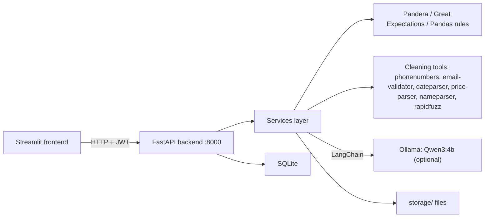

# Data Quality Inspector Architecture

**Last updated:** November 2026

How the Streamlit frontend, FastAPI backend, services layer, validation engines, optional local AI model, SQLite database and file storage work together to clean banking datasets.

## 1. Problem Statement

Banking datasets (customers, accounts, transactions, loans) arrive messy:

- Spelling variants: `Kolkatta`, `HomeLoan`, `F` vs `Female`
- Numbers stored as text: `₹ 133,121.49`
- Dates in many formats, and dummy values such as `2099-01-01` or `999999999`
- Invalid phone numbers and emails, duplicate rows, missing values

Cleaning these files by hand is slow, inconsistent and hard to audit. This project automates detection and cleaning, keeps a human in control of every change, re-checks the result, and produces a cleaned Excel file with a report.

## 2. Overview

- **Run mode:** runs locally. Two processes: the FastAPI backend and the Streamlit frontend. No Docker or external services are required.
- **Ingress:** the user works in the Streamlit app. Streamlit calls the FastAPI backend over HTTP with a JWT token.
- **Persistence:** SQLite for users, datasets and learning history; the `storage/` folder for uploaded files, cleaned files and reports.
- **AI is optional:** the local model (Qwen3:4b through Ollama) can be switched off. Everything else works without it.

## 3. Component Catalog

### Frontend: Streamlit (`frontend/`)

- **Role:** login, upload, column mapping, issue review, recommendation review, results and downloads
- **Files:** `app.py` (main screen), `views/` (upload and workflow pages), `services/api.py` (all calls to the backend)
- **Backend address:** `API_BASE_URL` (default `http://127.0.0.1:8000`)

### Backend: FastAPI (`app/`)

- **Port:** `8000`
- **Role:** authentication, dataset endpoints, orchestration of the cleaning pipeline
- **Structure:**
  - `main.py`: starts the app and registers routes
  - `core/`: settings from `.env`, password hashing and JWT
  - `api/routes/`: `auth.py`, `datasets.py`
  - `models/`, `schemas/`, `database/`: tables, request and response formats, connection
  - `services/`: all the logic (see below)

### Endpoints

| Method | Endpoint | Purpose |
|---|---|---|
| POST | `/auth/register`, `/auth/login` | Create a user, get a JWT |
| GET | `/datasets` | List the user's datasets |
| POST | `/datasets/upload` | Upload, inspect, suggest column mapping |
| POST | `/datasets/{id}/mappings/confirm` | Confirm column mapping |
| POST | `/datasets/{id}/analyze` | Profile, validate, consolidate issues |
| POST | `/datasets/{id}/recommendations` | Generate cleaning recommendations |
| POST | `/datasets/{id}/review` | Approve, reject or modify actions |
| POST | `/datasets/{id}/clean` | Clean, verify, build the report |
| GET | `/datasets/{id}/download` | Cleaned Excel file |
| GET | `/datasets/{id}/report` | HTML report |
| DELETE | `/datasets/{id}` | Delete a dataset and its files |

All dataset endpoints require `Authorization: Bearer <token>`.

### Services layer (`app/services/`)

| File | Role |
|---|---|
| `pipeline.py` | Controller: runs the steps in order and saves progress |
| `io_utils.py` | Reads CSV and Excel, fixes mixed-type columns |
| `inspection.py` | Row and column counts, data types, samples |
| `mapping.py`, `banking_rules.py` | Column mapping; banking fields, allowed values, ranges |
| `checks.py` | Core row-level checks used by every other step |
| `profiling.py` | Statistics, patterns, dummy and unusual values |
| `validation.py` | Pandera + Great Expectations + custom rules, merged into one issue list |
| `ai_context.py`, `ai_discovery.py`, `llm.py` | Optional AI step through LangChain and Ollama |
| `verification.py`, `results.py` | Verifies AI findings on all rows, builds the combined result |
| `recommendation.py`, `history.py` | Cleaning actions, data-loss guard, learning history |
| `tools.py` | Library cleaning tools and the synonym table |
| `cleaning.py` | Runs approved actions in a fixed order |
| `postcheck.py`, `quality.py`, `report.py` | Re-validation, quality score, cleaned Excel and HTML report |

### Optional AI: Qwen3:4b (Ollama + LangChain)

- **Role:** explain issues, suggest extra findings, refine recommendations
- **Rule:** the AI never changes data. Every AI finding is verified by Python on all rows before it is used. The AI can only choose from a fixed list of actions.
- **Switch:** `LLM_ENABLED=true|false`

### Data stores

| Store | Role |
|---|---|
| SQLite (`banking_cleaner.db`) | Users, datasets and their state, column mapping history, learning history |
| `storage/` folder | Uploaded files, cleaned Excel, HTML reports |

## 4. Topology



## 5. Workflow

```
Login (JWT)
   ↓
1. Upload → 2. Inspection → 3. Column mapping → 4. Profiling → 5. Validation
   ↓
6. Recommendations → 7. Human review → 8. Cleaning → 9. Verification → 10. Report
```

1. **Upload:** the user uploads an Excel or CSV file and picks a banking category and purpose. The file is saved under `storage/<dataset id>/`.
2. **Inspection:** Pandas reads the whole file, counts rows and columns, finds data types and takes sample values. Columns with mixed types (for example dates mixed with text) are converted to one type.
3. **Column mapping (no AI):** each column is matched to a banking field using past mappings, an alias table, fuzzy name matching (RapidFuzz) and value patterns. The user confirms or edits the result. Confirmed mappings are remembered.
4. **Profiling:** missing %, unique and duplicate counts, min, max and average, common patterns, dummy values, unusual values and correlations.
5. **Validation:** three engines check the data and their results are merged into one issue list with row counts, severity and sample values:
   - Pandera: types, ranges, formats
   - Great Expectations: required, unique, regex
   - Custom Pandas rules: whitespace, case, outliers, duplicates, dummy values, cross-column checks
6. **Recommendations:** each issue gets one cleaning action from a fixed list. The optional AI adds explanations. If an action would delete more than 5% of rows, it becomes "flag only" and the user decides.
7. **Human review:** the user approves, rejects or modifies each action, can edit category mappings (for example `Chk` to `Checking`) and sees data-loss warnings. Decisions are saved to the learning history.
8. **Cleaning:** only approved actions run, in a fixed order, and every action is logged with the rows affected.
9. **Verification:** the same checks run again on the cleaned data. Before and after counts are compared and each approved fix is confirmed.
10. **Report:** the cleaned Excel (data, cleaning log, before and after, issues found) and an HTML report.

### Cleaning order and tools

| Order | Technique | Example | Tool |
|---|---|---|---|
| 1 | Strip whitespace | `" Female "` becomes `Female` | Pandas |
| 2 | Placeholder to empty | `N/A`, `not available` | Pandas |
| 3 | Dummy value removal | `2099-01-01`, `999999999` | Pandas, NumPy |
| 4 | Unify case | `DELHI`, `delhi` become `Delhi` | Pandas |
| 5 | Merge categories | `Kolkatta` to `Kolkata`, `F` to `Female` | rapidfuzz, synonym table |
| 6 | Fix names | `Nair, Karan` becomes `Karan Nair` | nameparser |
| 7 | Type conversion | `₹ 133,121.49` becomes `133121.49` | price-parser, Pandas |
| 8 | Date parsing | `20-Sep-2008` becomes `2008-09-20` | dateparser |
| 9 | Phone and email fixes | `95010 57741` becomes `9501057741` | phonenumbers, email-validator |
| 10 | Range and rule fixes | future dates, credit score above 900 | Pandera, Pandas |
| 11 | Fill `Unknown` | missing Gender, Email, Phone | Pandas |
| 12 | Remove duplicates | exact duplicate rows | Pandas |
| 13 | Flag only | missing amounts, outliers | no change, listed for review |

## 6. Request Path (summary)

1. Streamlit button calls a function in `frontend/services/api.py`.
2. The call reaches a route in `app/api/routes/datasets.py` with the JWT token.
3. The route calls `services/pipeline.py`.
4. The pipeline calls the service for that step and saves the result in SQLite.
5. The response is shown in Streamlit.

## 7. Environment Highlights

| Variable | Purpose |
|---|---|
| `SECRET_KEY` | JWT signing |
| `DATABASE_URL` | SQLite database location |
| `STORAGE_DIR` | Folder for uploads, cleaned files and reports |
| `CORS_ORIGINS` | Allowed browser origins for the backend |
| `LLM_ENABLED` | Turn the AI step on or off |
| `OLLAMA_BASE_URL`, `OLLAMA_MODEL` | Local model address and name (`qwen3:4b`) |
| `LLM_TIMEOUT_SECONDS` | Maximum wait for the model |
| `ENABLE_GREAT_EXPECTATIONS` | Turn the Great Expectations engine on or off |
| `ENABLE_YDATA` | Optional extra HTML profile (off by default, slow) |
| `API_BASE_URL` | Backend address used by the Streamlit frontend |

## 8. Safety Rules

- Only approved actions are applied.
- Actions that would delete more than 5% of rows are flagged, not applied, unless the user chooses otherwise.
- Missing dates and transaction amounts are never invented.
- The AI never changes data, and its findings are verified first.
- Every action is logged with the rows affected.

## 9. Known Limitations

- Some problems need a business decision: customers under 18, zero transaction amounts, median-filled values.
- Synonyms not in the table (for example `Bombay` for `Mumbai`) are added by the user during review.
- Wrong but valid-looking values cannot be detected.
- "Issues remaining" counts only the problems the rules can detect.

## 10. Related Docs

- [README.md](./README.md): installation and how to run
